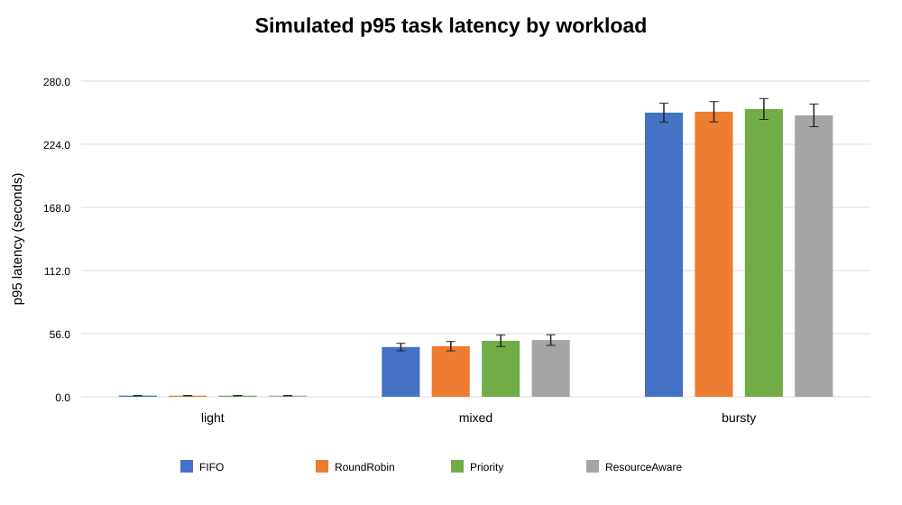
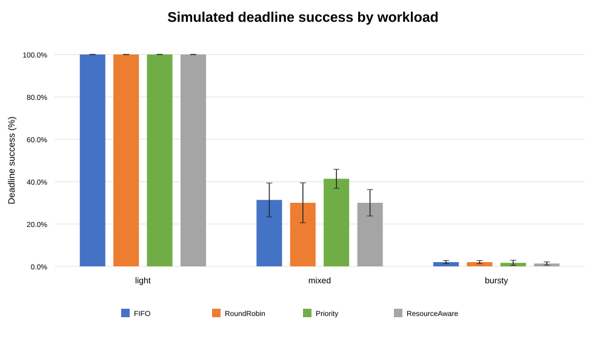
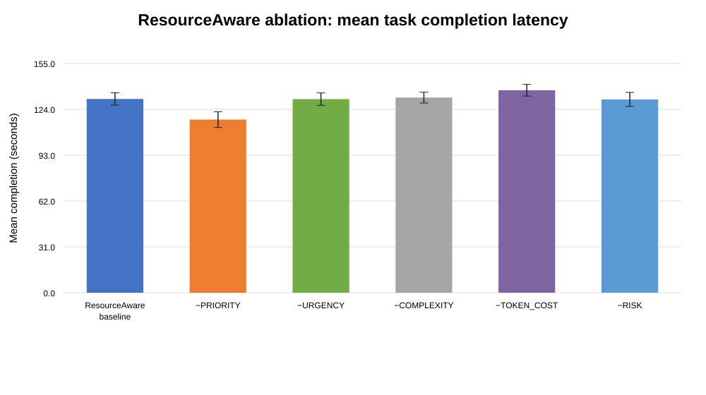
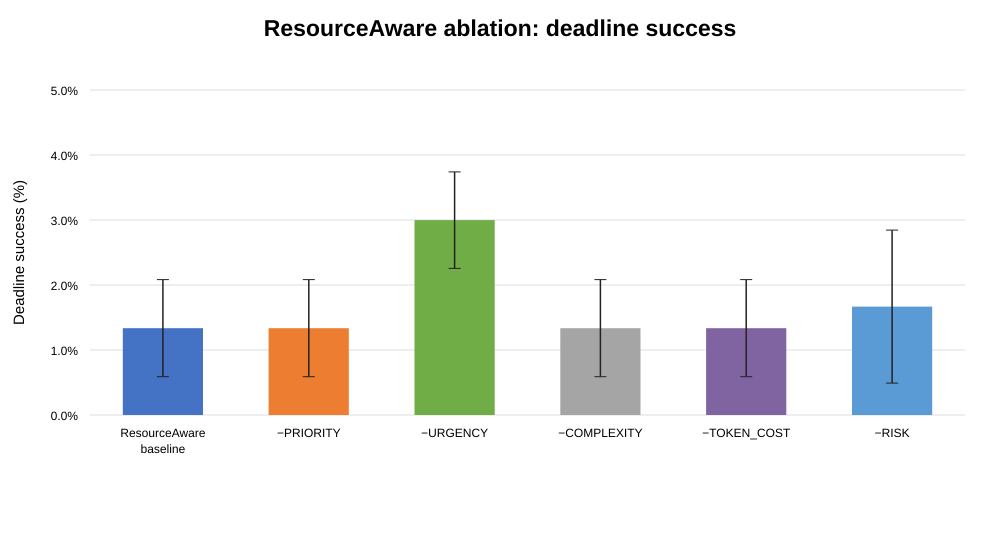
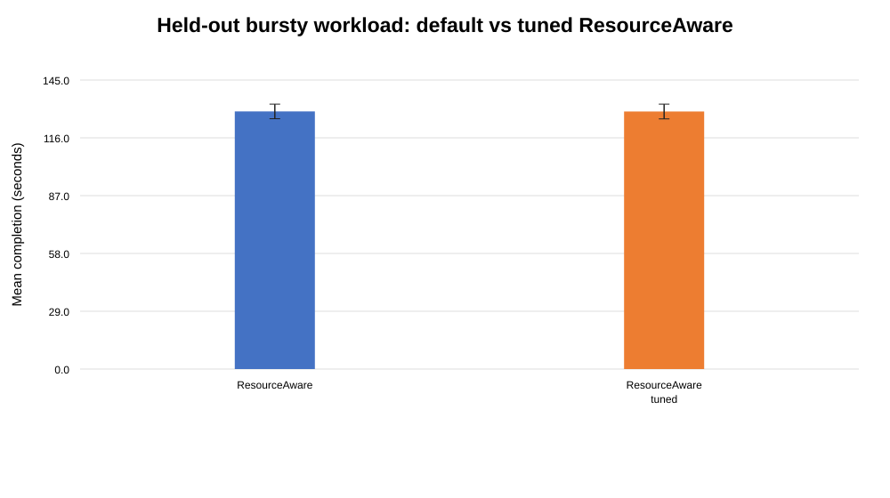

# Day 7 paper sections: Evaluation and Scheduler Design

> **Data provenance note.** The primary quantitative results below are computed from `experiments/simulated_results.csv` and `experiments/experiment_summary.csv`. The Day 5 table is from `experiments/day5/day5_summary.csv` and is mock-only. The uploaded archive did not contain P5 figure assets or a successful real-Qwen Day 5 CSV, so the included SVG figures were generated from the available CSVs. No real-model result is inferred or fabricated.

## Evaluation

### Experimental setup

The evaluation compares FIFO, Round-Robin, Priority, and ResourceAware on three simulated workloads: **light** (12 tasks per seed), **mixed** (30 tasks per seed), and **bursty** (60 tasks per seed). The primary experiment uses five fixed seeds (11, 23, 37, 41, and 59) for each workload and scheduler. Every scheduler receives the same generated workload for a given workload/seed pair. The main simulation therefore provides five independent seed-level observations per scheduler/workload combination.

The project setup supplied for this study identifies the target machine as an Intel Core i7-12700F with 16 GB RAM and CPU-only inference. Qwen2.5-1.5B is the intended local model for the real-model check. However, the primary CSV results are **simulated scheduling results**, not measured Qwen inference on that hardware. In the simulator, task service duration is modelled from estimated tokens, complexity, and a small random jitter; resource pressure for ResourceAware is a workload-dependent synthetic input. Thus, the hardware/model description is context for the intended deployment, not a claim that the main results are real hardware measurements.

The main results are reported as mean ± sample standard deviation across the five seeds. For each seed, task latency is calculated as completion time minus arrival time (`end − arrival`); p50 and p95 are computed over task latencies within that seed, then averaged across seeds. Makespan follows the simulation metric (`max(end) − min(start)`). Estimated token budgets are summed per run in the simulation. Deadline success is the percentage of tasks meeting their deadline; deadline misses are counted per run. These definitions are important because the simulation has a single serial worker, and task service durations do not change with scheduler order.

### Main results

**Table 1** reports the CSV-derived results. All entries are mean ± standard deviation; `n = 5` seeds for each row. The full numeric data is also available in `day7_main_metrics.csv`.

| Workload | Scheduler | p50 latency (s) | p95 latency (s) | Makespan (s) | Estimated tokens/run | Deadline success (%) | Deadline misses/run |
| --- | --- | --- | --- | --- | --- | --- | --- |
| light | FIFO | 0.68 ± 0.14 | 1.01 ± 0.06 | 14.83 ± 1.70 | 525.4 ± 120.4 | 100.00 ± 0.00 | 0.00 ± 0.00 |
| light | Priority | 0.68 ± 0.14 | 1.01 ± 0.06 | 14.83 ± 1.70 | 525.4 ± 120.4 | 100.00 ± 0.00 | 0.00 ± 0.00 |
| light | ResourceAware | 0.68 ± 0.14 | 1.01 ± 0.06 | 14.83 ± 1.70 | 525.4 ± 120.4 | 100.00 ± 0.00 | 0.00 ± 0.00 |
| light | RoundRobin | 0.68 ± 0.14 | 1.01 ± 0.06 | 14.83 ± 1.70 | 525.4 ± 120.4 | 100.00 ± 0.00 | 0.00 ± 0.00 |
| mixed | FIFO | 22.24 ± 4.77 | 44.12 ± 3.34 | 62.14 ± 2.38 | 4699.8 ± 227.4 | 31.33 ± 8.03 | 20.60 ± 2.41 |
| mixed | Priority | 20.78 ± 2.19 | 49.71 ± 5.17 | 62.14 ± 2.38 | 4699.8 ± 227.4 | 41.33 ± 4.47 | 17.60 ± 1.34 |
| mixed | ResourceAware | 19.07 ± 3.22 | 50.31 ± 4.72 | 62.14 ± 2.38 | 4699.8 ± 227.4 | 30.00 ± 6.24 | 21.00 ± 1.87 |
| mixed | RoundRobin | 21.86 ± 3.21 | 44.87 ± 4.15 | 62.14 ± 2.38 | 4699.8 ± 227.4 | 30.00 ± 9.43 | 21.00 ± 2.83 |
| bursty | FIFO | 137.94 ± 9.87 | 252.10 ± 8.43 | 269.10 ± 8.69 | 23592.8 ± 815.0 | 2.00 ± 0.75 | 58.80 ± 0.45 |
| bursty | Priority | 141.54 ± 4.07 | 255.29 ± 9.26 | 269.10 ± 8.69 | 23592.8 ± 815.0 | 1.67 ± 1.18 | 59.00 ± 0.71 |
| bursty | ResourceAware | 133.31 ± 6.05 | 249.69 ± 10.08 | 269.10 ± 8.69 | 23592.8 ± 815.0 | 1.33 ± 0.75 | 59.20 ± 0.45 |
| bursty | RoundRobin | 135.94 ± 12.20 | 252.88 ± 9.00 | 269.10 ± 8.69 | 23592.8 ± 815.0 | 2.00 ± 0.75 | 58.80 ± 0.45 |

On the light workload, all four schedulers tie on the reported metrics: p50 latency is 0.68 ± 0.14 s, p95 latency is 1.01 ± 0.06 s, makespan is 14.83 ± 1.70 s, and deadline success is 100%. This is a low-contention case and does not show an advantage for ResourceAware (Table 1).

On the mixed workload, Priority has the highest deadline success (41.33 ± 4.47%), while ResourceAware has the lowest mean p50 latency (19.07 ± 3.22 s) but the highest p95 latency (50.31 ± 4.72 s) among the four schedulers. ResourceAware's p95 is about 14% higher than FIFO's 44.12 s, and its deadline success is lower than Priority's. This is a clear trade-off rather than an overall win (Table 1; Figure 1; Figure 2).

On the bursty workload, ResourceAware has the lowest p50 (133.31 ± 6.05 s) and p95 latency (249.69 ± 10.08 s). Its p95 is about 2.2% lower than Priority's, but deadline success is only 1.33 ± 0.75%, versus 2.00 ± 0.75% for FIFO and Round-Robin. All schedulers miss almost all deadlines under this severe overload, so the lower latency quantiles do not imply effective deadline satisfaction (Table 1; Figure 1; Figure 2).

Makespan is identical across schedulers within each workload to the precision reported. This follows from the current single-worker simulator: the same tasks and service-duration formula are used, and scheduling changes order rather than parallel capacity or total service demand. Consequently, these experiments do **not** demonstrate a makespan reduction by ResourceAware. Estimated-token totals are also identical across schedulers within a workload because each scheduler processes the same task set (Table 1).

### Ablation and tuning

The ablation experiments remove one ResourceAware score term at a time on the bursty workload and report five seeds in `experiment_summary.csv`. The baseline row is the default ResourceAware main experiment. The values below use the CSV's `mean_completion`, `makespan`, and `deadline_success_percent` fields.

| Configuration | Mean completion (s) | Makespan (s) | Deadline success (%) |
| --- | --- | --- | --- |
| ResourceAware baseline | 131.01 ± 4.15 | 269.10 ± 8.69 | 1.34 ± 0.75 |
| remove W_PRIORITY | 117.09 ± 5.35 | 269.10 ± 8.69 | 1.34 ± 0.75 |
| remove W_URGENCY | 130.91 ± 4.18 | 269.10 ± 8.69 | 3.00 ± 0.74 |
| remove W_COMPLEXITY | 131.94 ± 3.67 | 269.10 ± 8.69 | 1.34 ± 0.75 |
| remove W_TOKEN_COST | 136.92 ± 3.96 | 269.10 ± 8.69 | 1.34 ± 0.75 |
| remove W_RISK | 130.69 ± 4.75 | 269.10 ± 8.69 | 1.67 ± 1.18 |

Removing the priority term reduces mean completion latency from 131.01 ± 4.16 s to 117.09 ± 5.35 s in the bursty simulation, while deadline success remains 1.34 ± 0.75%. Removing token-cost increases mean completion latency to 136.92 ± 3.96 s. Removing the risk term changes mean deadline success to 1.67 ± 1.18%; removing urgency raises it to 3.00 ± 0.74%, although that remains very low in absolute terms. These results show that the score terms affect ordering and latency, but no ablation produces a practically high deadline-success rate in this overload scenario. Makespan remains 269.10 ± 8.69 s across the ablation rows, for the same single-worker reason.

Weight tuning uses a separate mixed-workload tuning set: seeds 11, 23, and 37. A grid search considers priority weights 2, 3, and 4 and urgency weights 1, 2, and 3, selecting the configuration with the highest deadline-success rate and then the lowest mean completion latency. The selected setting is `W_PRIORITY = 3.0` and `W_URGENCY = 1.0`; the remaining terms keep their default weights. It is then evaluated on held-out bursty seeds 101, 202, 303, 404, and 505. On that held-out set, ResourceAware mean completion is 129.247 ± 3.661 s and tuned ResourceAware is 129.196 ± 3.692 s, while deadline success is identical at 1.002 ± 0.915% for both. The 0.051 s difference is very small and does not establish a meaningful improvement (see `experiment_summary.csv` and Figure 5).

### Day 5 mock-versus-real split

The available Day 5 output is **mock-only**. It contains 12 tasks per scheduler, 366 modeled tokens, zero failures, and 100% deadline success. The reported mock p95 latency ranges from 15.969 s (Round-Robin) to 16.785 s (ResourceAware), and makespan ranges from 18.0636 s to 18.0734 s. The mock timing uses an assumed throughput near 20.32 tokens/s. These values are a separate 12-task mock harness and should not be combined with the larger seeded simulation table.

| Scheduler | p95 latency (s) | Makespan (s) | Deadline success | Tokens | Failures |
| --- | --- | --- | --- | --- | --- |
| FIFO | 15.979 | 18.0726 | 100.0% | 366 | 0 |
| RoundRobin | 15.969 | 18.0636 | 100.0% | 366 | 0 |
| Priority | 16.778 | 18.0665 | 100.0% | 366 | 0 |
| ResourceAware | 16.785 | 18.0734 | 100.0% | 366 | 0 |

No successful real-Qwen CSV is present in the uploaded archive. Therefore, a real-versus-mock ranking comparison and empirical calibration of the 20.32 tokens/s assumption remain pending. Do not describe the current results as proof that the mock faithfully predicts real inference.

### Limitations

First, the main scheduler results are simulated; generated service times are not measured LLM generation times. Second, the bursty workload is intentionally overloaded and produces very low deadline success for every scheduler. Third, the single-worker model makes makespan largely invariant to scheduling order and does not model concurrent execution, batching, model loading, or actual CPU/RAM contention. Fourth, the workload uses five seeds per main condition, and the Day 5 mock harness has only 12 tasks. Fifth, the current CSVs do not provide isolated per-task CPU/RAM attribution for the main simulation. The archive also did not contain P3 security-metric tables, so no security-performance numbers are included here; those should be added only after coordination with P3. Finally, no successful real-Qwen run was included in this archive. Results should therefore be presented as preliminary simulator evidence, not a production-performance claim.

## Scheduler design

### Problem statement and baselines

Agentic-OS schedules incoming agent tasks under constrained local resources: a single local model/worker, finite CPU and RAM, and tasks that differ in priority, complexity, estimated token budget, deadline, and risk level. The scheduler must decide which queued task to dispatch next. A policy that optimizes one attribute alone can starve other tasks or miss deadlines, so the project compares three simple baselines with an explainable resource-aware score.

- **FIFO** dispatches tasks in enqueue order. It is simple and stable but does not explicitly account for urgency, priority, estimated cost, or risk.
- **Round-Robin** interleaves queues by agent type, improving service rotation between agent categories but not ranking individual tasks by deadline or resource cost.
- **Priority** dispatches the highest numeric priority first, preserving enqueue order for ties. It is responsive to priority but does not directly consider task size, deadline urgency, or resource pressure.

### ResourceAware score

The implemented scheduler computes a score for each queued task and dispatches the highest-scoring task. The formula in `backend/scheduler/resource_aware.py` is:

\[
S(t)=3P(t)+2U(t)-C(t)(1+R)-0.01T(t)-2K(t)R
\]

where:

- \(P(t)\) is the task's numeric priority.
- \(U(t)\) is deadline urgency. It is zero when no deadline is specified; it is 10 when the deadline is overdue; otherwise it is \(\min(10,\,10/(1+\text{remaining seconds}))\).
- \(C(t)\) is the task's complexity.
- \(T(t)\) is the estimated token budget.
- \(K(t)\) is the task risk level.
- \(R\) is normalized resource pressure, computed as the larger of CPU and memory utilization divided by 100 and clamped to the interval [0, 1].

The positive priority and urgency terms raise a task's score. Complexity and estimated token cost reduce the score, discouraging expensive work from dominating the queue. The risk penalty is multiplied by resource pressure, so high-risk work is penalized more when CPU or memory pressure is high. If scores tie, the implementation prefers the task that entered the scheduler earlier. This is a heuristic ranking score, not a calibrated estimate of task execution time or a formal deadline guarantee.

### Weight selection and security boundary

Weights were tuned separately from the held-out evaluation. The grid search tested `W_PRIORITY` in (2, 3, 4) and `W_URGENCY` in (1, 2, 3) on mixed-workload seeds 11, 23, and 37. It maximized aggregate deadline-success percentage, breaking ties by lower mean completion latency. The selected priority/urgency weights were 3.0 and 1.0, respectively; complexity, token-cost, and risk weights remained 1.0, 0.01, and 2.0. The selected configuration was then evaluated on five unseen bursty seeds (101, 202, 303, 404, 505). The held-out results show only a 0.051 s lower mean completion latency and no deadline-success change versus the default ResourceAware weights, so the tuning result should not be presented as a substantial improvement (Figure 5).

The current implementation does **not** implement model-tier routing or a dedicated low-privilege queue. Its risk term is a scheduling penalty only; it is not an access-control mechanism and does not restrict tool permissions. If a model-tier or low-privilege queue is required in a later version, it should be implemented and evaluated explicitly before being claimed as part of this scheduler. In the current paper, the accurate statement is that ResourceAware incorporates priority, urgency, complexity, estimated token cost, and resource-conditioned risk into task ordering.

### Design takeaway

ResourceAware is an explainable multi-factor scheduler and it lowers the simulated latency quantiles in the bursty case, but it loses on mixed-workload p95 and deadline success compared with Priority. In the current serial simulation, none of the schedulers reduces makespan. These outcomes support describing ResourceAware as a trade-off explored by the prototype, not as a universally superior policy (Table 1; Figures 1–5).
