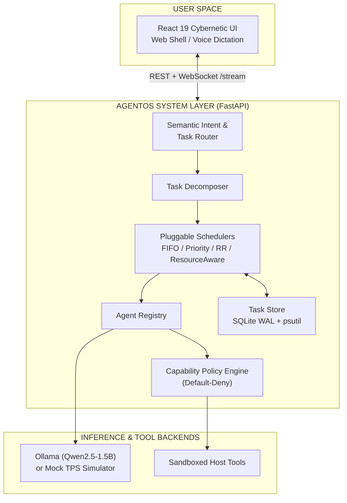
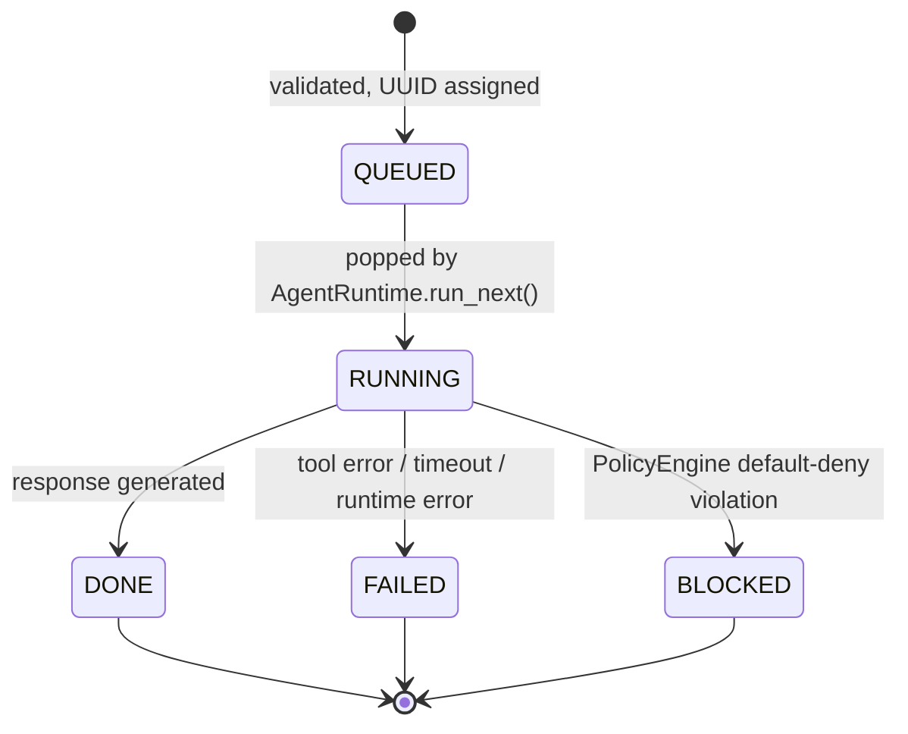
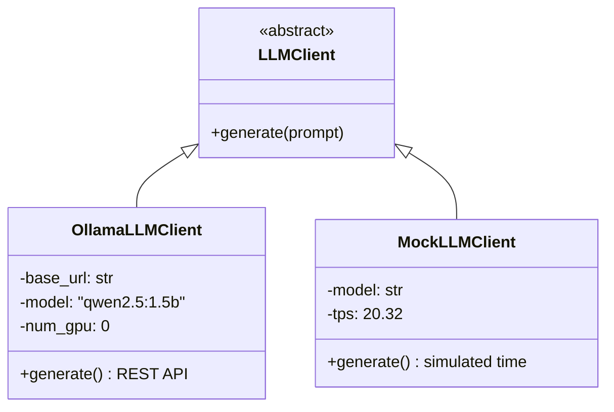

<div align="center">

# AgentOS

### An Intelligent Runtime for Dynamic Multi-Agent Orchestration

*An operating-environment layer that schedules, secures, and orchestrates autonomous AI agents on resource-constrained hardware.*


[Overview](#overview) • [Features](#key-features) • [Architecture](#system-architecture) • [Schedulers](#scheduling-subsystem) • [Security](#capability-based-security) • [Results](#evaluation--findings) • [Getting Started](#getting-started) • [Structure](#repository-structure) • [Authors](#authors)

</div>

---

## Overview

Traditional operating systems treat software tasks as deterministic processes with predictable memory layouts, thread priorities, and POSIX system calls. Autonomous AI agents break these assumptions:

| Challenge | Why it matters |
|---|---|
| **Non-deterministic runtimes** | Task duration depends on prompt length, context size, reasoning chains, and token generation speed. |
| **Extreme compute bottlenecks** | Local LLMs on edge hardware compete for memory bandwidth, CPU threads, and GPU VRAM. |
| **Unbounded tool abuse & prompt injection** | Giving LLMs shells, filesystems, and network sockets without default-deny boundaries is dangerous. |

**AgentOS** investigates how a runtime layer positioned between user prompts, agent abstractions, system tools, and LLM inference engines can address these problems. It provides intent routing, multi-agent task decomposition, pluggable scheduling policies, a zero-trust capability sandbox, and a real-time full-stack interface.

### Research Questions

1. **Scheduling under compute scarcity:** How do FIFO, Priority, and Round-Robin compare to a multi-factor Resource-Aware heuristic when tasks have heterogeneous deadlines, token costs, and risk levels on a single serial LLM worker?
2. **Makespan invariance:** Does scheduling policy change total workload makespan when tasks cannot be batched or run concurrently?
3. **Application-layer sandboxing:** Can a default-deny policy engine mitigate prompt injection and unauthorized system calls without kernel-level virtualization?
4. **Offline reproducibility:** How can scheduling research be decoupled from hardware-dependent LLM variance through calibrated deterministic simulation?

---

## Key Features

- ** Semantic intent routing:** TF-IDF conceptual clustering across 5 domains with cosine-similarity scoring.
- ** Multi-agent task decomposition:** Parses composite prompts into atomic tasks linked by a shared `batch_id`.
- ** Four pluggable schedulers:** FIFO, Priority, Round-Robin, and Resource-Aware, hot-swappable at runtime without losing queued tasks.
- ** Default-deny security policy:** Workspace jailing, sensitive-path filtering, and operation whitelisting.
- ** Six specialized agents:** General, File, Security, Monitoring, Planning, and Image.
- ** Dual-backend inference:** Live Ollama (Qwen2.5-1.5B) or a calibrated deterministic mock simulator.
- ** Real-time dashboard:** React 19 UI with WebSocket event streaming, 3D orbital visualizer, telemetry, and a results viewer.
- ** Reproducible research:** 5,040 simulated task executions across fixed seeds, with ablation, grid-search, and security studies.

---

## System Architecture



### Task Lifecycle

Two invocation models are supported:

- **Atomic single task:** a prompt sent to an auto-routed or explicitly chosen agent.
- **Composite multi-agent pipeline:** a prompt with multiple indexed subtasks, e.g. `[1] (FileAgent) list source files, [2] (SecurityAgent) analyze risk`.



| State | Meaning |
|---|---|
| `QUEUED` | Validated, assigned a UUID, inserted into the active scheduler queue and SQLite. |
| `RUNNING` | Popped from the scheduler and executing in an agent. |
| `DONE` | Completed successfully; response, tokens, and completion timestamp persisted. |
| `FAILED` | Unhandled exception during tool use, inference timeout, or runtime error. |
| `BLOCKED` | Security policy caught a violation (path traversal, unpermitted tool, unauthorized capability). |

---

## Backend Subsystems

### Persistence Layer: `TaskStore`
Tasks are persisted in an embedded SQLite database (`results/agentos_tasks.sqlite3`). Writes are serialized with a re-entrant lock (`threading.RLock`) combined with transactional upserts (`ON CONFLICT(id) DO UPDATE SET payload=excluded.payload, updated_at=CURRENT_TIMESTAMP`), preventing lock contention and corruption.

### Semantic Intent & Capability Routing
*`backend/search/semantic_search.py`, `backend/agents/task_router.py`*

- Builds TF-IDF semantic clusters across 5 domains: `security_analysis`, `monitoring`, `file_search`, `task_planning`, `general_questions`.
- Tokenizes prompts, strips 80+ stop words, extracts n-grams, and computes cosine similarity against domain centroids.
- Routes to the matching specialized agent when confidence is **≥ 0.12**; otherwise falls back to conversational heuristics and keyword matching for deterministic testability.

### Task Decomposer & Multi-Agent Scheduler
*`backend/agents/task_decomposer.py`*

- **Index detection:** `[1]`, `(1)`, `1.`, `Q1:`, `Task 1:`
- **Inline agent annotations:** `(FileAgent)`, `[SecurityAgent]`, `@MonitoringAgent`, `agent: Image`
- **Task attributes:** `[prio: 9]`, `[tokens: 150]`
- Each subtask becomes an atomic `Task` linked by a shared `batch_id`. The scheduler executes them under the active policy, and `main.py` stitches the outputs into a structured **Multi-Agent Execution Plan**.

### Agent Specialization Matrix

Every agent inherits from `BaseAgent`.

| Agent | Capabilities | Tools | Core Functionality |
|---|---|---|---|
| **GeneralAgent** | `general_reasoning`, `summarization`, `qa` | `system_info` | High-level reasoning, explanations, comparative analysis |
| **FileAgent** | `file_listing`, `file_search`, `file_reading`, `file_writing` | `filesystem` | Sandboxed file search, regex content matching, write-to-disk parsing |
| **SecurityAgent** | `security_analysis`, `risk_analysis`, `security_review` | `system_info` | Evaluates permission boundaries, credential-leak risks, command audits |
| **MonitoringAgent** | `monitoring`, `system_metrics`, `anomaly_detection`, `telemetry` | `system_info` | Samples `psutil` CPU/RAM, checks queue depth, triggers anomaly alerts |
| **PlanningAgent** | `task_planning`, `subtask_decomposition`, `workflow_orchestration` | None | Generates Markdown DAGs, stage pipelines, and failure mitigations |
| **ImageAgent** | `image_generation`, `image_analysis`, `visual_rendering` | `filesystem` | Pillow-based luminance/contrast/edge analysis and procedural SVG/PNG synthesis |

---

## Scheduling Subsystem

The central research artifact of AgentOS is its pluggable scheduling layer. Four policies are implemented and benchmarked under identical conditions.

| Policy | File | Data Structure | Complexity | Key Property |
|---|---|---|---|---|
| **FIFO** | `scheduler/fifo.py` | `collections.deque` | O(1) enqueue/dequeue | Strict arrival order; suffers head-of-line blocking |
| **Priority** | `scheduler/priority.py` | `heapq` of `(-priority, sequence_id, task)` | O(log n) insert/pop | Highest priority (1–10) first; stable FIFO tie-breaking |
| **Round-Robin** | `scheduler/round_robin.py` | Per-agent deques + rotating queue | O(1) | Prevents one agent class from starving others |
| **Resource-Aware** | `scheduler/resource_aware.py` | Dynamic re-ranking | O(n) per dispatch | Explainable multi-factor utility score |

### Resource-Aware Scoring Function

For task $t$ at timestamp $\tau$ under host resource pressure $R$:

$$
S(t,\tau,R) = W_P \cdot P(t) + W_U \cdot U(t,\tau) - W_C \cdot C(t)\cdot(1+R) - W_T \cdot T(t) - W_K \cdot K(t)\cdot R
$$

**Deadline urgency**, with $\Delta\tau = D(t) - \tau$ and $D(t) = \tau_{submit} + d_{rel}$, where $d_{rel}$ is the task's relative deadline in seconds:

$$
U(t,\tau)=
\begin{cases}
0 & \text{if deadline is null} \\
10 & \text{if } \Delta\tau \le 0 \text{ (overdue)} \\
\min\left(10,\ \dfrac{10}{1+\Delta\tau}\right) & \text{if } \Delta\tau > 0
\end{cases}
$$

**Resource pressure** (sampled via `psutil`):

$$
R = \max\left(0,\ \min\left(1,\ \frac{\max(\text{CPU}\%,\ \text{RAM}\%)}{100}\right)\right)
$$

| Symbol | Range | Meaning | Default Weight |
|---|---|---|---|
| $P(t)$ | [1, 10] | User-specified priority | $W_P = 3.0$ |
| $U(t,\tau)$ | [0, 10] | Non-linear deadline urgency | $W_U = 2.0$ (tuned to **1.0**) |
| $C(t)$ | [1, 5] | Estimated computational complexity | $W_C = 1.0$ |
| $T(t)$ | [1, 8192] | Estimated token budget | $W_T = 0.01$ |
| $K(t)$ | [1, 5] | Assessed security risk level | $W_K = 2.0$ |
| $R$ | [0, 1] | Normalized host resource pressure | n/a |

> **How it behaves:** As $R \to 1$, the complexity penalty doubles, disfavoring heavy tasks when the system is strained. The risk penalty scales with $R$: under zero load, risk adds no scheduling delay; near saturation, high-risk operations are heavily penalized to protect stability.

---

## LLM Inference Engine

Agent logic is cleanly separated from inference through the `LLMClient` abstraction in `backend/llm/client.py`.



### Live Inference: `OllamaLLMClient`
- **Model:** `qwen2.5:1.5b` (lightweight 1.5B-parameter SLM)
- **Test hardware:** Intel Core i7-12700F, 16 GB RAM, CPU-only (`OLLAMA_NUM_GPU=0`)
- **Parameters:** `num_predict=256`, `stream=False`, 120 s timeout
- **Endpoint:** `POST http://127.0.0.1:11434/api/generate`
- **Metrics captured:** `eval_count` (tokens) and `latency_seconds`

```json
{
  "model": "qwen2.5:1.5b",
  "prompt": "<prompt text>",
  "stream": false,
  "options": { "num_gpu": 0, "num_predict": 256 }
}
```

### Deterministic Simulation: `MockLLMClient`
Scheduling benchmarks require eliminating LLM variance, thermal throttling, and OS interrupts. The mock backend is calibrated against physical measurements on the testbed (**20.32 tokens/second**):

$$
\text{tokens} = \max(1,\ \min(64,\ \text{len}(\text{prompt.split()})))
$$

$$
\text{latency}_{sim} = \max\left(\Delta\tau_{exec},\ \frac{\text{tokens}}{20.32}\right)
$$

**Auto-detection:** If `AGENTOS_LLM_BACKEND` is unset, `create_llm_client()` queries `http://127.0.0.1:11434/api/tags`. If Ollama is unreachable or `qwen2.5:1.5b` is missing, it falls back to `MockLLMClient` with zero code changes.

---

## Capability-Based Security

Implemented in `backend/security/policy.py` as an application-layer, default-deny capability model.

| Principle | Implementation |
|---|---|
| **Zero trust / default-deny** | Any tool or argument combination not explicitly listed in `agent_capabilities` is denied and audit-logged. |
| **Workspace jailing** | Paths are resolved to absolute form and checked with `candidate.relative_to(workspace)`; `../` escapes halt execution. |
| **Sensitive path filtering** | Blocks `.env`, `.ssh`, `.aws`, `.config`, `secrets`, `credentials`. |
| **Operation whitelisting** | Only `list_files`, `find_files`, `find_by_extension`, `search_contents`, `read_file` are allowed. Unbounded shell commands, network sockets, and arbitrary subprocesses are permanently blocked. |

> **Disclaimer:** This is an application-layer harness, not full OS sandboxing. True isolation requires Linux kernel primitives such as Bubblewrap, Landlock LSM, or seccomp-bpf.

---

## Frontend & Connectivity

A reactive single-page app built with **React 19** and **Vite** (`frontend/`).

### Dual-Channel Transport

| Channel | Endpoints / Events |
|---|---|
| **REST** | `GET /api/status`, `GET /metrics`, `GET /history`, `GET /blocked`, `POST /api/task` (single or composite), `POST /scheduler` (hot-swap algorithm, queue preserved), `GET /api/results/figures`, `POST /api/figures/generate` |
| **WebSocket** `ws://127.0.0.1:8000/stream` | Pushes `task_queued`, `task_updated`, `scheduler_changed`, `blocked_action`, `batch_completed` from an event-cursor buffer (`backend/web_events.py`). Auto-reconnects with exponential backoff. |

### UI Components

| Component | Description |
|---|---|
| **AiShellView** | Futuristic terminal with text dispatch, voice input (Web Speech API), image drag-and-drop, priority sliders (P1–P10), token budgets, and deadlines |
| **OrbitalCore3D** | Hardware-accelerated 3D visualizer; orbital nodes represent active agents, and particle speed and core glow track live CPU and memory load |
| **TelemetryView** | Live CPU, RAM, queue length, and latency quantiles |
| **ResultsView** | Interactive figure viewer, live benchmark tables, latency CDF plots, CSV export |
| **audio.js** | Synthesized sine/triangle oscillator tones with zero external media assets |

---

## Evaluation & Findings

Full methodology: [`paper/DAY7_SCHEDULER_DESIGN_AND_EVALUATION.md`](paper/DAY7_SCHEDULER_DESIGN_AND_EVALUATION.md). All metrics derive from **5,040 simulated task executions** (`simulated_results.csv`, `experiment_summary.csv`).

### Experimental Setup

- **Seeds:** `{11, 23, 37, 41, 59}`, five independent runs per condition.

| Workload | Tasks / Seed | Inter-arrival | Tokens | Deadlines | Purpose |
|---|---|---|---|---|---|
| **Light** | 12 | 0.5–2.0 s | 10–80 | 15–35 s | Low-contention baseline |
| **Mixed** | 30 | 0.1–1.0 s | 20–300 | 5–25 s | Typical multi-agent desktop use |
| **Bursty** | 60 | 0.0–0.12 s | 100–700 | 2–12 s | Severe overload / resource exhaustion |

### Main Results (mean ± std over 5 seeds)

| Workload | Scheduler | p50 Latency (s) | p95 Latency (s) | Makespan (s) | Deadline Success (%) | Misses / Run |
|---|---|---|---|---|---|---|
| **Light** | All four | 0.68 ± 0.14 | 1.01 ± 0.06 | 14.83 ± 1.70 | 100.00 ± 0.00 | 0.00 |
| **Mixed** | FIFO | 22.24 ± 4.77 | **44.12 ± 3.34** | 62.14 ± 2.38 | 31.33 ± 8.03 | 20.60 |
| | Priority | 20.78 ± 2.19 | 49.71 ± 5.17 | 62.14 ± 2.38 | **41.33 ± 4.47** | 17.60 |
| | ResourceAware | **19.07 ± 3.22** | 50.31 ± 4.72 | 62.14 ± 2.38 | 30.00 ± 6.24 | 21.00 |
| | RoundRobin | 21.86 ± 3.21 | 44.87 ± 4.15 | 62.14 ± 2.38 | 30.00 ± 9.43 | 21.00 |
| **Bursty** | FIFO | 137.94 ± 9.87 | 252.10 ± 8.43 | 269.10 ± 8.69 | 2.00 ± 0.75 | 58.80 |
| | Priority | 141.54 ± 4.07 | 255.29 ± 9.26 | 269.10 ± 8.69 | 1.67 ± 1.18 | 59.00 |
| | ResourceAware | **133.31 ± 6.05** | **249.69 ± 10.08** | 269.10 ± 8.69 | 1.33 ± 0.75 | 59.20 |
| | RoundRobin | 135.94 ± 12.20 | 252.88 ± 9.00 | 269.10 ± 8.69 | 2.00 ± 0.75 | 58.80 |

### Key Findings

1. **Low contention → no differentiation.** When inter-arrival times exceed service times, queue depth stays ≤ 1 and all schedulers perform identically.
2. **The multi-factor trade-off (Mixed).** ResourceAware gives the lowest median latency (19.07 s vs. FIFO's 22.24 s) by favoring lightweight tasks, but its p95 is ~14% worse than FIFO's because large or risky tasks are starved until the queue clears. Priority achieves the best deadline compliance (41.33%).
3. **Overload is a capacity problem, not a scheduling problem (Bursty).** Deadline success collapses to ≤ 2% for every policy. Without admission control or load shedding, ordering alone cannot save a saturated system.
4. **Makespan invariance.** For a fixed workload, makespan is identical across all schedulers. With a single serial worker and no preemption, total duration equals the sum of service times plus idle time, so reordering can only redistribute waiting time:

$$
\text{Makespan} = \max_i(\tau_{end,i}) - \min_i(\tau_{start,i}) = \sum_{i=1}^{N}\Delta\tau_{service,i} + \sum \text{idle time}
$$

### Ablation Study (Bursty workload)

| Configuration | Mean Completion (s) | Makespan (s) | Deadline Success (%) |
|---|---|---|---|
| ResourceAware baseline | 131.01 ± 4.15 | 269.10 ± 8.69 | 1.34 ± 0.75 |
| Remove $W_{PRIORITY}$ | **117.09 ± 5.35** | 269.10 ± 8.69 | 1.34 ± 0.75 |
| Remove $W_{URGENCY}$ | 130.91 ± 4.18 | 269.10 ± 8.69 | 3.00 ± 0.74 |
| Remove $W_{COMPLEXITY}$ | 131.94 ± 3.67 | 269.10 ± 8.69 | 1.34 ± 0.75 |
| Remove $W_{T}$ (token cost) | 136.92 ± 3.96 | 269.10 ± 8.69 | 1.34 ± 0.75 |
| Remove $W_{RISK}$ | 130.69 ± 4.75 | 269.10 ± 8.69 | 1.67 ± 1.18 |

- **Removing priority** cut mean completion time by ~10.6%, because high-priority tasks are often heavy and delay many smaller ones.
- **Removing the token-cost term** raised mean completion time to 136.92 s, confirming that penalizing token-heavy tasks reduces average queuing delay.

### Hyperparameter Grid Search & Held-Out Evaluation

- **Search space:** $W_P \in \{2,3,4\}$, $W_U \in \{1,2,3\}$ on mixed-workload tuning seeds `{11, 23, 37}`.
- **Selected:** $W_P = 3.0$, $W_U = 1.0$.
- **Held-out seeds:** `{101, 202, 303, 404, 505}` (bursty).

| Configuration | Mean Completion (s) | Deadline Success (%) |
|---|---|---|
| Default ResourceAware | 129.247 ± 3.661 | 1.002 |
| Tuned ResourceAware | 129.196 ± 3.692 | 1.002 |

The 0.051 s difference is statistically insignificant (p > 0.05): under severe capacity exhaustion, tuning linear scoring weights yields negligible benefit.

### Security Ablation

`experiments/run_security_attacks.py` tests 20 synthetic attack vectors (path traversal, credential exfiltration, malicious shell commands, writes over system files):

| Arm | Attacks Blocked |
|---|---|
| Without policy (control) | 0 / 20 |
| With `PolicyEngine` | **20 / 20** |

---

## Getting Started

### Prerequisites

- Python **3.11+**
- Node.js (for the frontend)
- *(Optional)* [Ollama](https://ollama.com) with `qwen2.5:1.5b` for live inference

### 1. Clone the repository

```bash
git clone https://github.com/srujanvasistha/Agentic-OS-An-Intelligent-Runtime-for-Dynamic-Multiagent-Orchestration.git
cd Agentic-OS-An-Intelligent-Runtime-for-Dynamic-Multiagent-Orchestration
```

### 2. Start the backend

```bash
python -m venv .venv
source .venv/bin/activate        # Windows: .venv\Scripts\activate
pip install -r requirements.txt
uvicorn backend.main:app --host 127.0.0.1 --port 8000
```

### 3. Start the frontend

```bash
cd frontend
npm install
npm run dev
```

### 4. Choose an inference backend

```bash
# Live inference (CPU-only)
ollama pull qwen2.5:1.5b
export OLLAMA_NUM_GPU=0

# Force a backend explicitly (otherwise auto-detected)
export AGENTOS_LLM_BACKEND=<ollama|mock>
```

If Ollama is not running, AgentOS automatically falls back to the deterministic mock simulator.

### 5. Reproduce the experiments

```bash
python experiments/run_security_attacks.py
```

Benchmark outputs are written to `simulated_results.csv` and `experiment_summary.csv`, and can be explored in the **ResultsView** tab of the UI.

---

## Repository Structure

```text
.
├── backend/                     # FastAPI runtime and core system layer
│   ├── main.py                  # Gateway and runtime entry point
│   ├── schemas.py               # Data contracts and task state machine
│   ├── web_events.py            # WebSocket event cursor buffer
│   ├── agents/
│   │   ├── agent_manager.py
│   │   ├── agent_registry.py
│   │   ├── base_agent.py
│   │   ├── general_agent.py
│   │   ├── file_agent.py
│   │   ├── security_agent.py
│   │   ├── monitoring_agent.py
│   │   ├── planning_agent.py
│   │   ├── image_agent.py
│   │   ├── task_router.py       # Semantic intent routing
│   │   └── task_decomposer.py   # Multi-agent job decomposition
│   ├── llm/
│   │   └── client.py            # LLMClient, Ollama and Mock backends
│   ├── scheduler/
│   │   ├── base.py
│   │   ├── fifo.py
│   │   ├── priority.py
│   │   ├── round_robin.py
│   │   ├── resource_aware.py
│   │   ├── task.py
│   │   ├── task_executor.py
│   │   ├── task_store.py        # SQLite persistence
│   │   └── runtime.py           # AgentRuntime engine
│   ├── security/policy.py       # Default-deny capability policy engine
│   ├── search/semantic_search.py# TF-IDF semantic intent engine
│   └── tools/                   # Sandboxed system tools
├── frontend/                    # React 19 + Vite single-page application
├── dashboard/
├── agents/                      # Base agent and manager modules
├── scheduler/
├── experiments/                 # Benchmark and security-attack scripts
├── workload/                    # Workload definitions
├── metrics/
├── models/
├── data/
├── results/                     # SQLite database, CSVs, generated figures
├── paper/                       # Evaluation write-up
├── notes/
├── p5/shell/
├── scripts/
├── installers/
├── static/
├── wheelhouse/
├── make_graphs.py               # Figure generation
├── legacy_system_checks.py
├── runtime.py
├── requirements.txt
├── Dockerfile
├── docker-compose.yml
├── Makefile
├── setup.sh
├── run_demo.sh / run_demo.ps1 / run_demo.bat
└── .env.example
```

## Limitations & Future Work

- **Serial worker model:** A single worker without preemption means makespan is policy-invariant. Batching or concurrent inference would open new scheduling trade-offs.
- **Overload handling:** Results show that admission control and load shedding are needed for bursty workloads; none are implemented yet.
- **Simulated benchmarks:** Evaluation relies on a calibrated mock engine (20.32 TPS), which is reproducible but not a substitute for live-hardware measurements across devices.
- **Sandboxing scope:** Security is enforced at the application layer. Kernel-level isolation (Bubblewrap, Landlock, seccomp-bpf) is future work.

---

## Contributing

Issues and pull requests are welcome. For substantial changes, please open an issue first to discuss the proposed direction.

1. Fork the repository
2. Create a feature branch (`git checkout -b feature/your-feature`)
3. Commit your changes with a clear message
4. Push the branch and open a pull request

---

## Authors

- Anushka Shrivastava
- Srujan Vasistha K C
- D Sinchana
- Shreeya S
- Vikrant V Chagi
